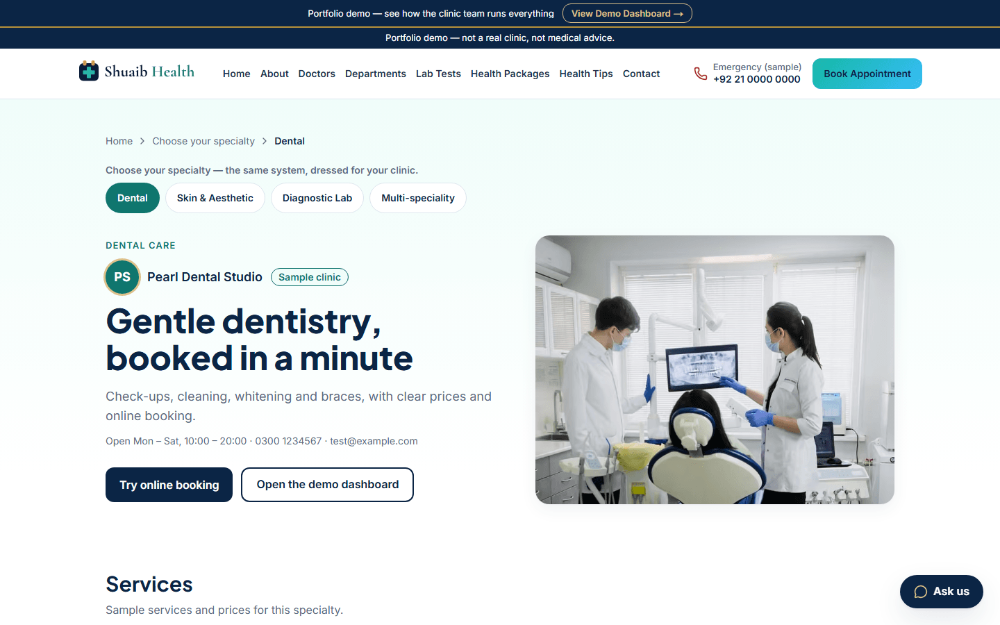
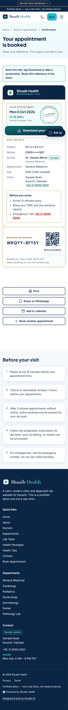
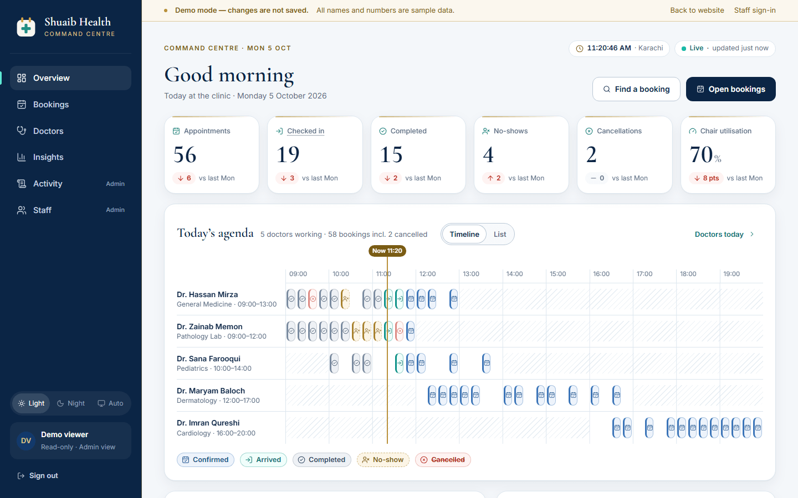
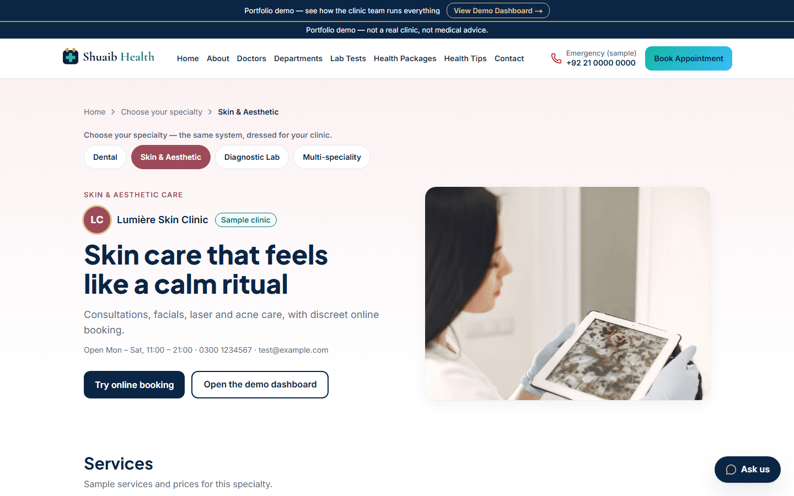
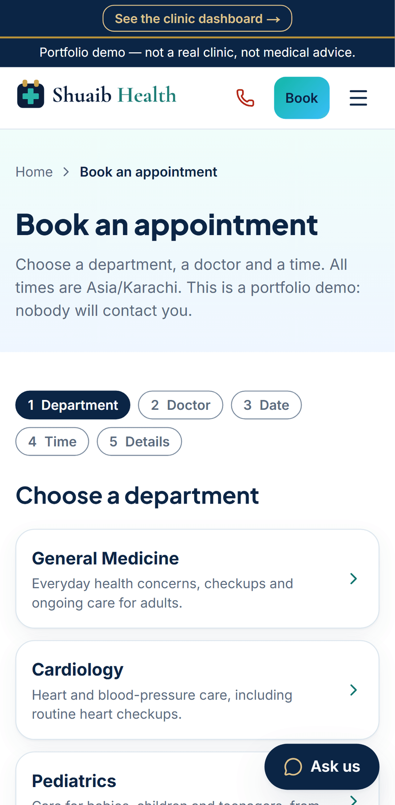
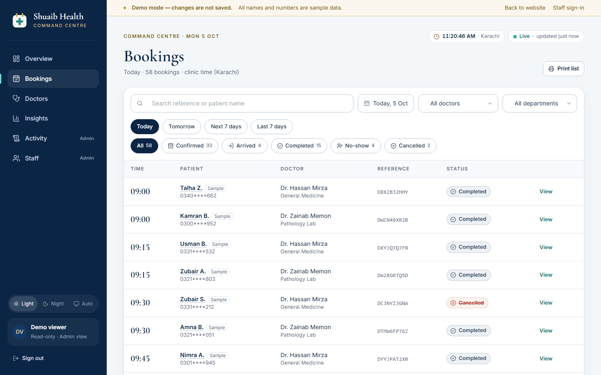

# Shuaib Health

A **portfolio demo** of a premium, white-label clinic system: a fast public website, online booking with a
QR/PDF slip, a private staff dashboard (the Command Centre), specialty presets and an assistant. Built for
clinics in Pakistan, the Gulf and the UK.

> **Portfolio demo — not a real clinic, not medical advice.**
> Designed & built by [Shuaib Ali](https://github.com/Shuaibali0786).

## Features

| | What it does |
|---|---|
| **Clinic website** | Home, departments, doctors with weekly schedules and fees, lab tests with preparation and report time, health packages, health tips, FAQ, contact with an opt-in map. Mobile first, light and fast. |
| **Online booking** | Department → doctor → date → time → details. Real free slots from the server, double booking blocked in the database, rate-limited. |
| **Booking slip** | Confirmation with a reference, a PDF slip with a QR code, print, calendar file and a share link. Personal details are masked. |
| **Command Centre** | Staff dashboard: today's agenda by doctor, live status flow with undo, search and filters with quick date ranges, insights charts, doctors today, audit log, staff roles, print list. Light and night themes. |
| **One-click demo** | Visitors open the dashboard with sample data, no password. Nothing is saved. |
| **Specialty presets** | The same system shown as a Dental, Skin & Aesthetic, Diagnostic Lab or Multi-speciality clinic (`/demo/specialties`). *(PR #24)* |
| **Assistant** | "Ask us" chat that answers from the clinic's own data (timings, doctors, tests, fees) and guides to booking; a clinic-owner guide on the demo. Free, no AI key; off by default. *(PR #25)* |
| **Security & privacy** | Argon2 passwords, secure cookies, CSRF and Origin checks, server-side roles, audit log, masked phones, no personal data in logs, CSP, secret scanning. |
| **Quality** | TypeScript strict, 1,400+ unit tests, Playwright end-to-end, accessibility (axe) and visual tests in CI. |

## Screenshots

All screenshots use sample data from a local build. Full set: [`docs/showcase/`](docs/showcase/README.md).

| Specialty presets | Booking slip | Command Centre |
|---|---|---|
|  |  |  |
|  |  |  |

<!-- Placeholder: add the 60–90 s demo video link here (script: docs/showcase/DEMO-VIDEO-SCRIPT.md). -->
<!-- Placeholder: add the live demo link here once Shuaib approves sharing it. -->

## Project

| Part | Folder |
|------|--------|
| Website and staff app (Next.js 16, TypeScript, Tailwind v4) | [`frontend/`](frontend/README.md) |
| API (FastAPI, SQLModel, Neon Postgres) | [`backend/`](backend/README.md) |

- Project rules: [`.specify/memory/constitution.md`](.specify/memory/constitution.md)
- How we change things safely: [`docs/SAFE-CHANGE-PLAYBOOK.md`](docs/SAFE-CHANGE-PLAYBOOK.md)
- Feature specs, plans and tasks: [`specs/`](specs/)
- Architecture decisions: [`history/adr/`](history/adr/)
- Prompt history: [`history/prompts/`](history/prompts/)

To run the backend locally on Windows, follow [`backend/README.md`](backend/README.md).
