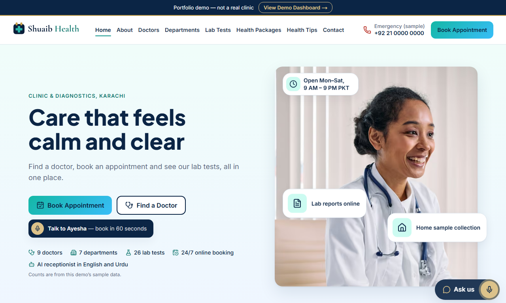
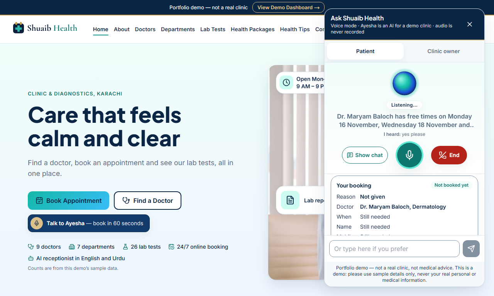
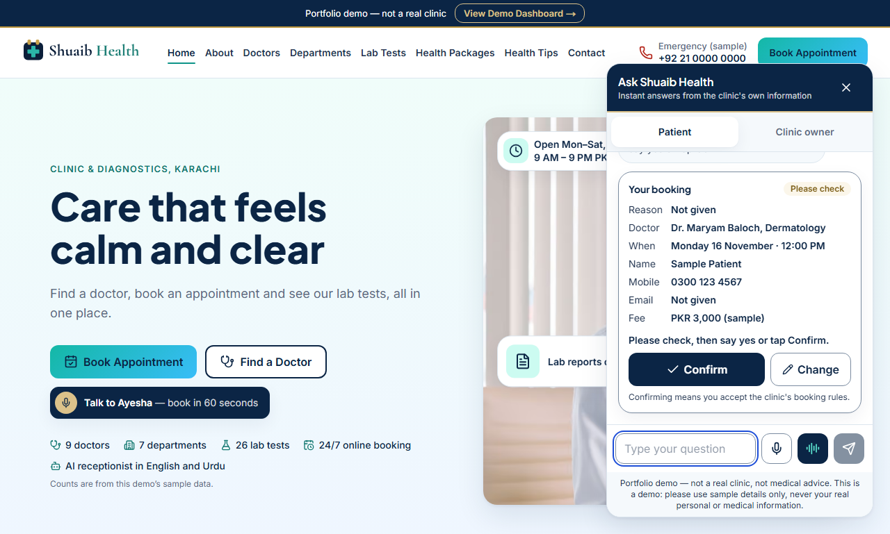
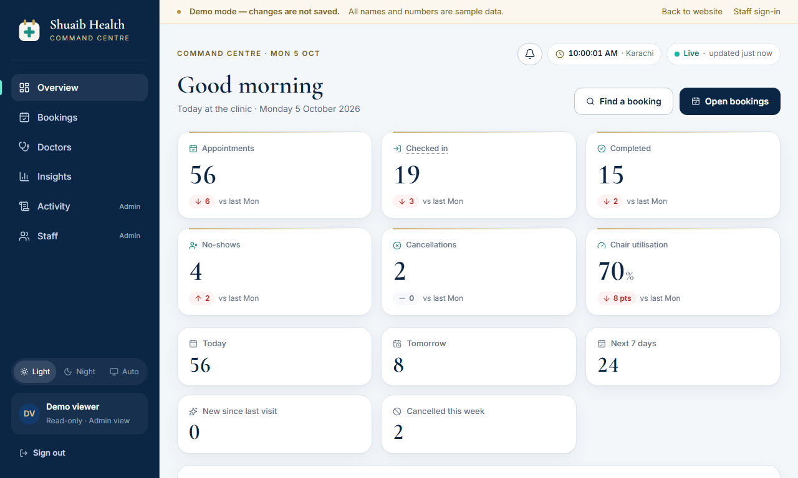
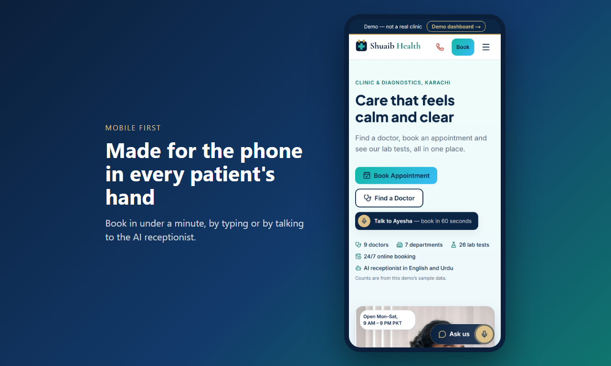
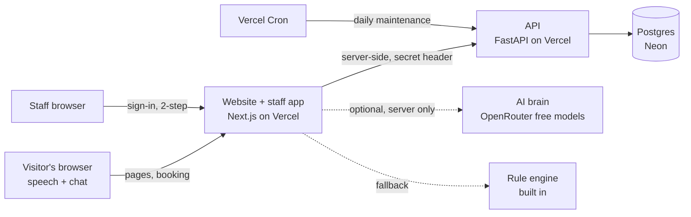

# Shuaib Health

[](https://github.com/Shuaibali0786/shuaib-health/actions/workflows/ci.yml)

**A clinic website with online booking, a staff dashboard and an AI voice receptionist that books appointments in English and Urdu.**

> **Portfolio demo: not a real clinic, not medical advice.** All names, numbers and bookings are sample data.
> Designed and built by [Shuaib Ali](https://github.com/Shuaibali0786).

- **Live demo:** https://shuaib-health-web.vercel.app
- **Demo dashboard:** open the live site and click **View Demo Dashboard** in the top bar (read-only, no password, nothing is saved).
- **Case study:** [`docs/marketing/case-study.md`](docs/marketing/case-study.md)

| Home, with the AI receptionist | Voice mode in a booking |
|---|---|
|  |  |

| Booking summary | Staff dashboard (demo) | On a phone |
|---|---|---|
|  |  |  |

## Features

| | What it does |
|---|---|
| **Clinic website** | Doctors with weekly schedules and fees, departments, lab tests with preparation and report time, health packages, health tips, FAQ and contact. Mobile first. |
| **Online booking** | Department, doctor, day, time, details. Free slots come from the server; double booking is blocked in the database; rate-limited. |
| **Booking slip** | A reference, a PDF slip with a QR code, print, calendar file and share link. Personal details are masked. |
| **Command Centre** | Staff dashboard: today's agenda by doctor, status flow with undo, search and filters, insights, audit log, staff roles, printable day list. Light and night themes. |
| **One-click demo** | Visitors open the dashboard with sample data, no password. Nothing is saved. |
| **Specialty presets** | The same system as a Dental, Skin & Aesthetic, Diagnostic Lab or Multi-speciality clinic. |
| **Two-step sign-in** | Authenticator app and backup codes for administrators. |

## AI voice receptionist ("Ayesha")

Talk to her from the **Talk to Ayesha** button on the home page, or the mic in the **Ask us** button. She also works by typing.

- Answers in **English or Urdu** (Roman Urdu or Urdu script) and follows the patient's language.
- Understands a problem ("I have an allergy", "mujhe bukhar hai"), suggests the right department and lists our doctors with days, hours and fees, then waits for the patient's choice.
- Books the appointment in the same conversation: day, a free time, name (spelled back), mobile number (read back in groups), optional email, then a full summary before the patient confirms. She never picks a time the patient did not choose.
- **Safe:** never diagnoses or gives doses; says the emergency number first when a message sounds urgent; books only after the patient's own "yes".
- **Private:** speech runs in the visitor's browser; **no audio is recorded or stored**.
- **Resilient:** an optional AI brain (OpenRouter free models) with a built-in rule engine as the fallback; typing always works if the microphone is blocked.
- Ends warmly with the slip link and a goodbye.

Details: [`docs/runbooks/voice-receptionist.md`](docs/runbooks/voice-receptionist.md), [`docs/voice-agent/`](docs/voice-agent/).

## Tech stack

| Layer | Choice |
|---|---|
| Website and staff app | Next.js 16 (App Router), React 19, TypeScript strict, Tailwind CSS v4 |
| API | Python 3.12, FastAPI, SQLModel, Alembic |
| Database | Postgres on Neon (Singapore) |
| Voice | Browser Web Speech API; optional OpenRouter AI brain with a local rules fallback |
| Hosting | Vercel (Singapore region), serverless functions and cron |
| Quality | Vitest, pytest, Playwright, axe accessibility, visual tests, GitHub Actions CI |
| Operations | Uptime monitoring, Sentry (scrubbed), secret scanning, dependency audits, encrypted daily backups |

## Architecture



The browser never talks to the API directly: the website forwards booking calls with a shared secret, so rate limits, lockouts and
validation live on the server. Rate limits are stored in Postgres, which is what makes them correct on serverless hosting.

## Security and privacy

- Argon2 password hashing, secure HTTP-only cookies, CSRF and Origin checks, roles enforced on the server, an audit log of staff actions.
- Phone numbers are masked on the slip, in share links and in the dashboard; no personal data in URLs or logs.
- Content-Security-Policy and security headers; staff pages are never indexed or cached.
- Secrets live only in environment variables, never in the repository; secret scanning runs in CI.
- This is a demo with sample data; it makes no medical or legal-compliance claims.

## Run it locally

You need Node 24, Python 3.12 with [uv](https://docs.astral.sh/uv/), and a Postgres database (a free Neon project works).

```bash
# API
cd backend
uv sync
copy .env.example .env        # then fill in the values (never commit .env)
uv run alembic upgrade head
uv run python -m app.seed     # demo data
uv run uvicorn app.main:app --reload --port 8000

# Website (in a second terminal)
cd frontend
npm install
npm run dev
```

Frontend settings are in `frontend/.env.example`. Voice is off unless `ASSISTANT_ENABLED=true` and `VOICE_ENABLED=true`. More detail:
[`frontend/README.md`](frontend/README.md) and [`backend/README.md`](backend/README.md).

## Tests and CI

```bash
cd frontend && npm run lint && npm run typecheck && npm test      # unit tests (about 2,170)
cd frontend && npm run test:e2e                                    # end-to-end, accessibility, visual
cd backend  && uv run pytest                                       # API tests (about 1,370)
```

GitHub Actions runs the backend, frontend, secret-scan and end-to-end jobs on every pull request, with branch protection on `main`.

## Project map

| Part | Folder |
|---|---|
| Website and staff app | [`frontend/`](frontend/README.md) |
| API | [`backend/`](backend/README.md) |
| Specs, plans and tasks | [`specs/`](specs/) |
| Architecture decisions | [`history/adr/`](history/adr/) |
| Runbooks (deploy, rollback, backups, admin password reset) | [`docs/runbooks/`](docs/runbooks/) |
| Portfolio assets (images, demo video draft, case study) | [`docs/marketing/`](docs/marketing/) |

## Credits and licence

Photos, icons, fonts and the map are listed with their sources and licences in [`CREDITS.md`](CREDITS.md).
No open-source licence has been granted for this code yet: it is shared as a portfolio piece, and all rights are reserved unless a
licence file says otherwise. For work with me, see the case study.
