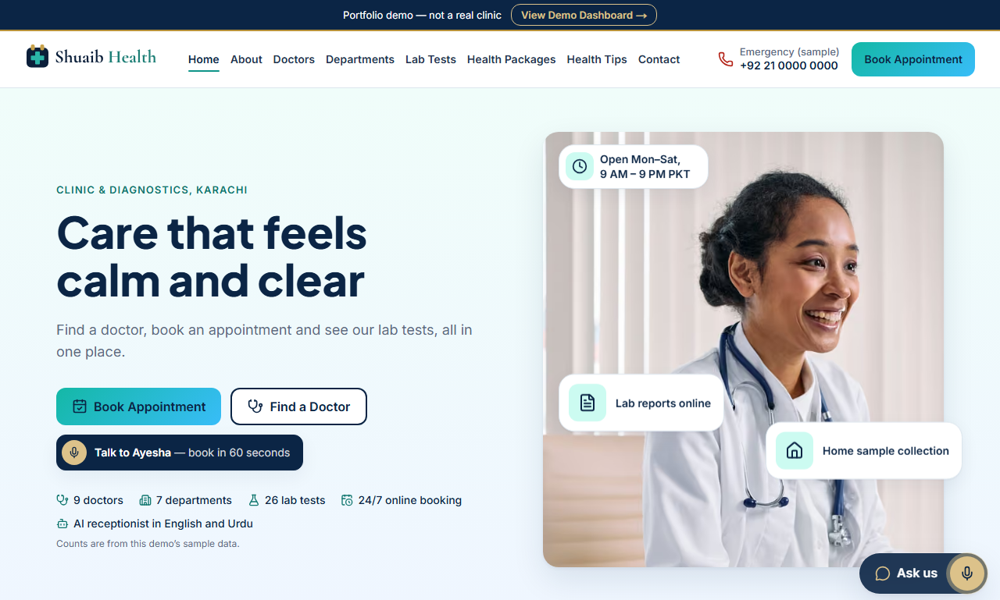
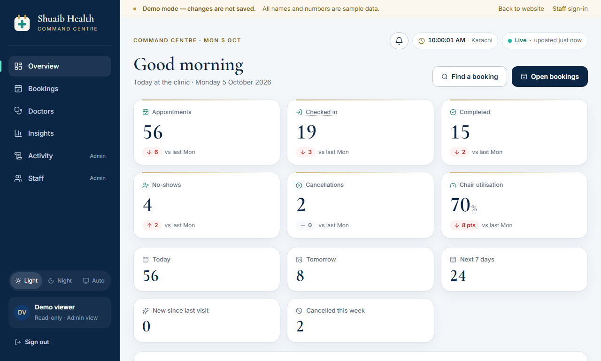
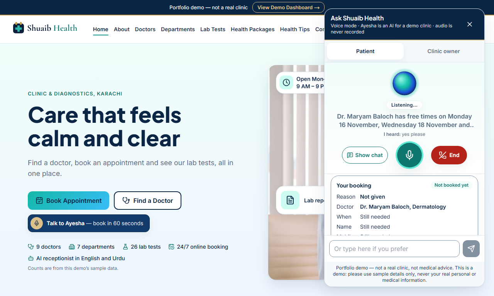
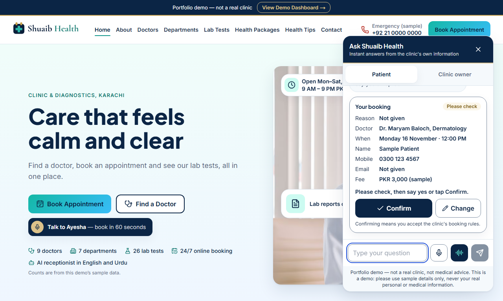
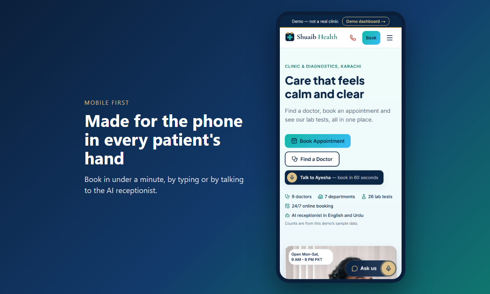

# Case study: Shuaib Health, a clinic website with an AI receptionist

*A portfolio demo with sample data, not a real clinic. Designed and built by Shuaib Ali.*
**Live demo:** https://shuaib-health-web.vercel.app (use "View Demo Dashboard" in the top bar to see the staff side, no password).

## The problem
Small clinics in Pakistan, the Gulf and the UK still take most bookings by phone and WhatsApp. Patients cannot see which
doctor is in today, what a test costs or whether they need to fast. The front desk juggles paper lists, double bookings
and no-shows, and the owner has no simple view of the day. Big hospital software is slow and costly, and generic website
builders cannot book real time slots safely.

## The solution
One white-label system a clinic can brand in a day:

- **A fast public website.** Doctors with weekly schedules and fees, departments, lab tests with preparation notes and
  report times, health packages, tips, FAQ and contact. The demo has 9 doctors, 7 departments and 26 lab tests (all sample data).
- **Online booking, 24/7.** Department, doctor, day, time, details. Free times come from the server and the database
  blocks double booking. The patient gets a confirmation slip with a reference, a QR code, a PDF, a calendar file and a share link.
- **A staff dashboard (the Command Centre).** Today's agenda by doctor, one-tap status changes with undo, search,
  upcoming bookings with a "new" bell, insights, an audit log, staff roles and a printable day list.
- **An AI receptionist named Ayesha** (below).
- **A one-click, read-only demo** so a prospective client can try the dashboard without an account.

## The AI voice receptionist
Ayesha answers in English or Urdu (Roman Urdu or Urdu script), by voice or by typing, and books the appointment in the same conversation.

- **Listens and speaks in the browser.** It uses the visitor's own browser for speech, so there is no per-minute cost and
  no audio is ever recorded or stored. A visible note says so.
- **Knows only the clinic's data.** Doctors, days, hours, fees and lab tests come from the clinic's own catalog, never from the model's memory.
- **Safe by design.** It never diagnoses or gives doses, says the emergency number first when a message sounds urgent, and books
  only after the patient's own clear "yes". A mistaken name, number or time is corrected in the conversation.
- **Careful with details.** Names are spelled back, the mobile number is read back in groups, and the full summary (doctor, day,
  date, time, fee) is shown and read aloud before confirming.
- **Never stuck.** If the AI service is slow or down, a built-in rule engine answers instead. If the microphone is blocked or the
  browser cannot listen, the visitor can type and the booking continues.
- **Tested hard.** 20 scripted patient conversations (English, Roman Urdu and mixed), a 13-device browser matrix and a voice test suite run on every change.

## Tech stack
| Layer | Choice |
|---|---|
| Website and staff app | Next.js 16 (App Router), React 19, TypeScript (strict), Tailwind CSS v4 |
| API | Python 3.12, FastAPI, SQLModel, Alembic |
| Database | Postgres on Neon (Singapore) |
| Voice | Browser Web Speech API for listening and speaking; an optional AI brain through OpenRouter's free models, with a local rules engine as the fallback |
| Hosting | Vercel (Singapore region), serverless functions, Vercel Cron for daily maintenance |
| Quality | Vitest, pytest, Playwright, axe accessibility checks, visual tests, GitHub Actions CI |
| Operations | Uptime monitoring, Sentry with personal data scrubbed, secret scanning, dependency audits, encrypted daily backups |

## Security and privacy
- Argon2 password hashing, secure HTTP-only cookies, CSRF and Origin checks, roles enforced on the server.
- Two-step sign-in (authenticator app and backup codes) for administrators.
- Rate limits and lockouts stored in Postgres, so they work correctly on serverless hosting; a honeypot field and per-phone limits on booking.
- Phone numbers are masked on the slip, in share links and in the dashboard; no personal data in URLs or logs; an audit log of staff actions.
- Content-Security-Policy and other security headers; staff pages are never indexed or cached.
- Demo bookings are deleted automatically a few days after the appointment.
- This is a demo with sample data. It makes no medical or legal-compliance claims.

## Results
- **Tests:** about 2,170 frontend unit tests, about 1,370 backend tests, 55 end-to-end test files in a real browser, and an
  accessibility check on every public page, all run in CI on every pull request.
- **Speed (Lighthouse 12.6.1 on the live site, 7 Nov 2026, 65 public pages):** mobile Performance 95 to 99, Accessibility 98 to
  100, Best Practices 100; desktop Performance 100 on every page. Largest Contentful Paint at most 2.6 s on mobile (simulated slow
  4G). The SEO score is lower on purpose: the demo clinic is set to "do not index" because it is not a real clinic.
- **For a clinic:** patients book any time without calling, staff see the whole day on one screen, and the owner sees trends
  (bookings, no-shows, busiest doctors) without spreadsheets.

## What I can build for you
Your clinic's own branded site and booking system, adapted to your specialty, languages and workflow, deployed, tested and handed
over with documentation. The AI receptionist can be switched on or off per clinic.
